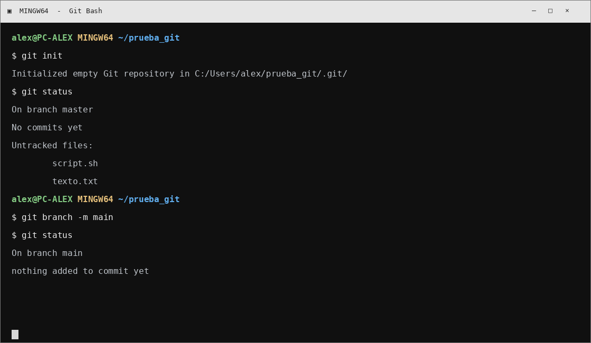
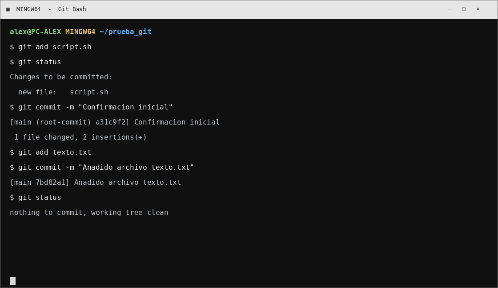
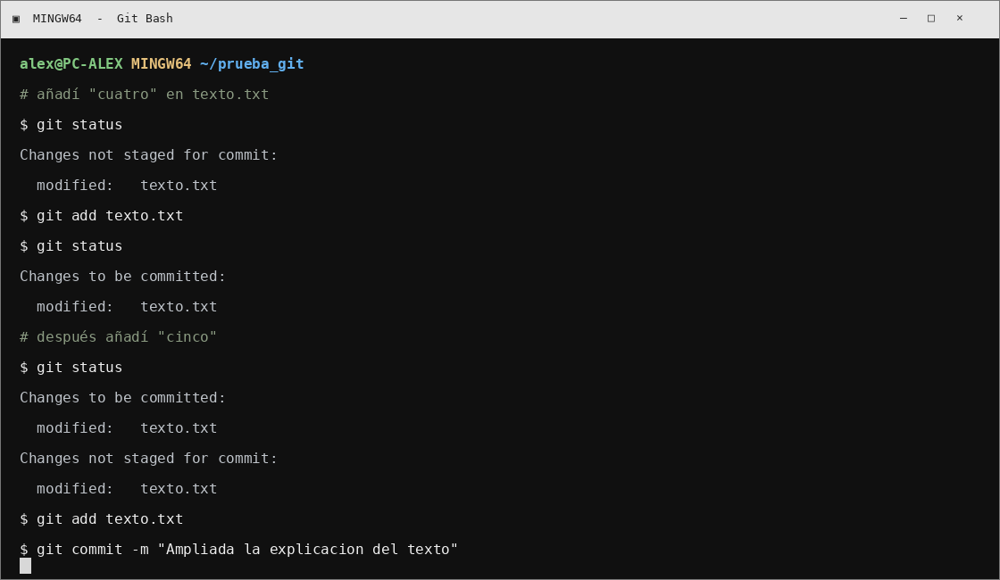
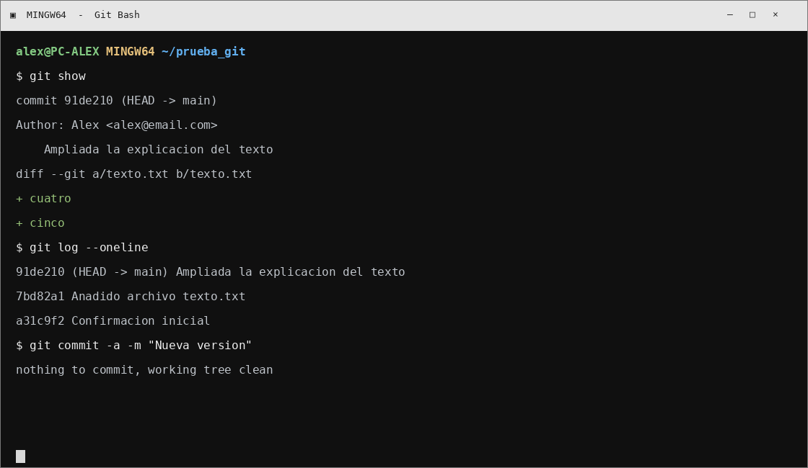
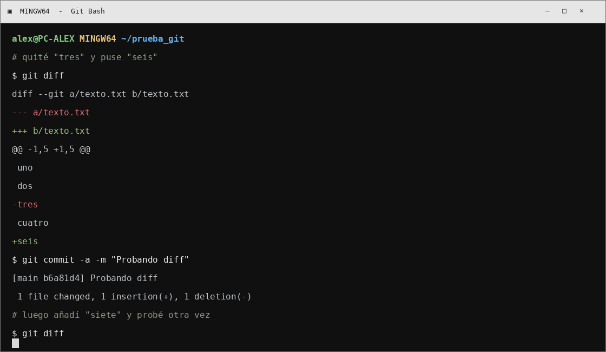
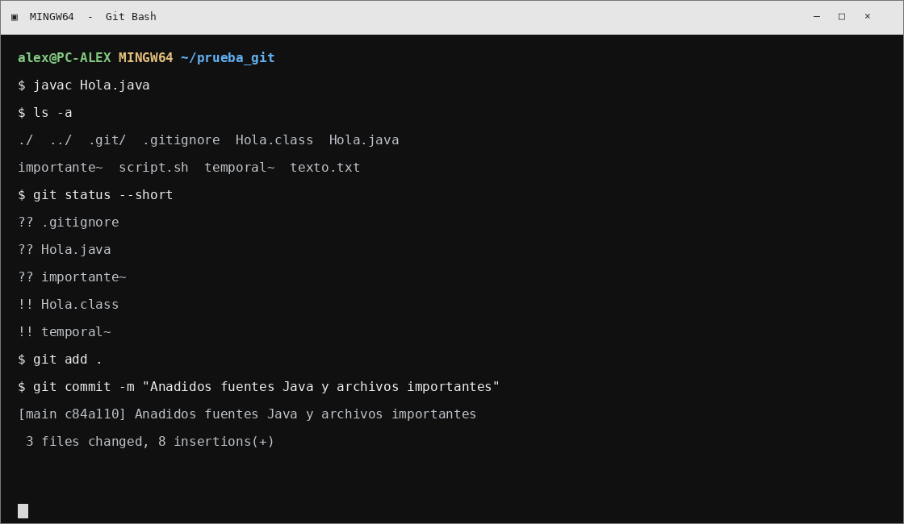
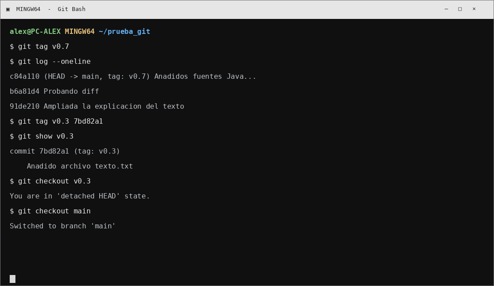
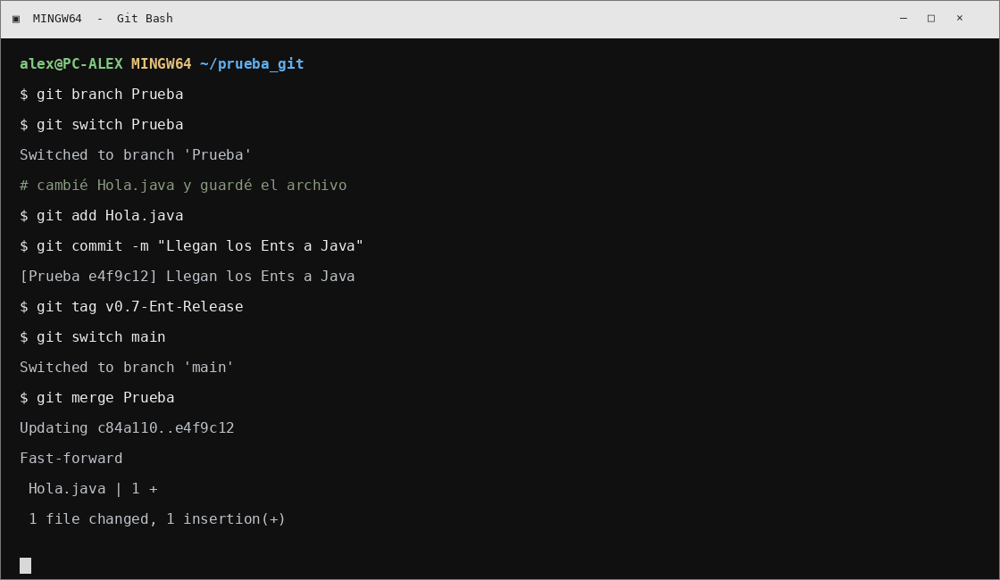
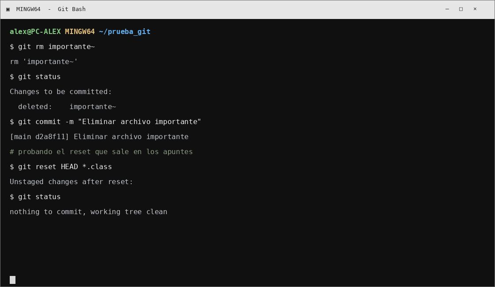
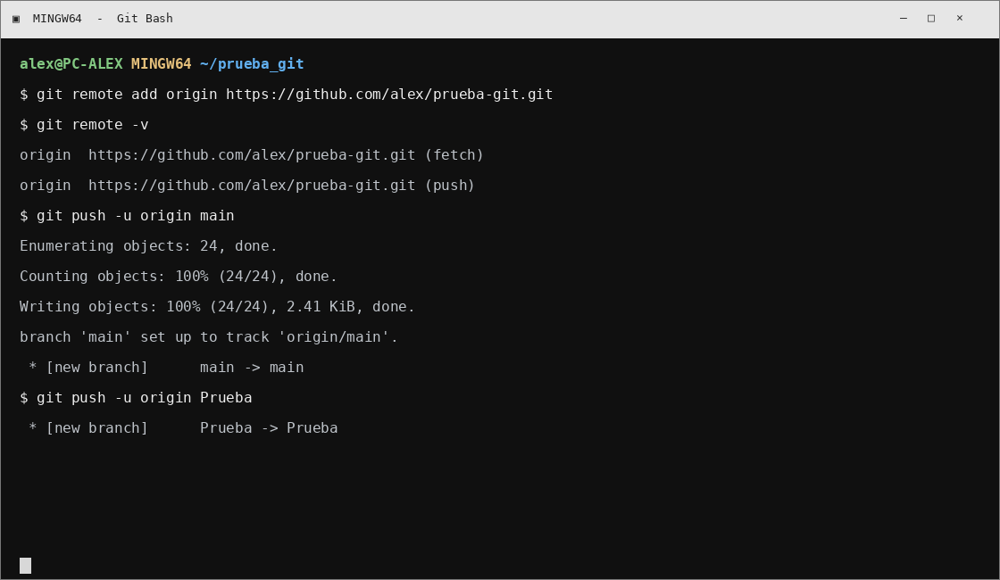

# Práctica Git y GitHub (pasos 1 al 10)

La idea es ir haciendo la práctica en la consola de Git para Windows, poco a poco. No hace falta que te salga exactamente igual que en las capturas: los nombres, hashes y algunos mensajes cambian según el ordenador.

Abre **Git Bash** (se instala con Git para Windows) y trabaja dentro de una carpeta llamada `prueba_git`. En las capturas aparece un usuario de ejemplo (`alex`), así que cambia las rutas, el correo y el enlace de GitHub por los tuyos.

## Antes de empezar

Instala Git para Windows desde https://git-scm.com/download/win y abre Git Bash. Primero configura tu nombre y correo:

```bash
git config --global user.name "Tu Nombre"
git config --global user.email "tu_correo@example.com"
git --version
git config --list
```

Crea la carpeta y entra en ella:

```bash
mkdir prueba_git
cd prueba_git
```

Dentro crea `texto.txt` con esto:

```text
uno
dos
tres
```

Y crea `script.sh`:

```bash
echo Listado completo
ls -l
```

Si quieres probarlo también:

```bash
chmod a+x script.sh
./script.sh
```

En Windows también puedes usar `dir` para ver los archivos. Las capturas están hechas con aspecto de una ventana de Git Bash en Windows.

---

## 1. Crear el repositorio



Estando dentro de `prueba_git`, escribe:

```bash
git init
git status
```

Git crea la carpeta oculta `.git`. En el `status` salen `texto.txt` y `script.sh` como archivos sin seguimiento (*untracked*), porque todavía no los hemos añadido.

En el tema también se cambia el nombre de la rama y se vuelve a dejar como estaba. Puedes probarlo así:

```bash
git branch -m main
git status
git branch -m master
```

Si tu instalación ya usa `main`, no pasa nada: adapta ese último cambio al nombre que tengas.

## 2. Añadir archivos y hacer los primeros commits



Primero añadimos solo el script:

```bash
git add script.sh
git status
```

Ahora lo guardamos en el historial:

```bash
git commit -m "Confirmacion inicial"
```

Después hacemos lo mismo con `texto.txt`:

```bash
git add texto.txt
git commit -m "Anadido archivo texto.txt"
git status
```

Con `git add` dejamos preparado el archivo (*stage*) y con `git commit` guardamos esa versión. Si todo está bien, al final saldrá `working tree clean`.

## 3. Tocar un archivo después de añadirlo



Abre `texto.txt` y añade `cuatro`. Mira qué dice Git:

```bash
git status
git add texto.txt
git status
```

Ahora vuelve a abrirlo y añade también `cinco`. Ejecuta otra vez:

```bash
git status
```

Puede que veas una modificación preparada y otra que todavía no lo está. Es normal: el `add` guarda lo que había en el archivo en ese momento. Para meter también la última edición, hay que repetirlo:

```bash
git add texto.txt
git commit -m "Ampliada la explicacion del texto"
git status
```

## 4. Mirar el historial



Para ver qué se ha ido guardando, prueba:

```bash
git show
git log
git log --oneline
```

`git show` enseña el último commit con sus cambios. `git log` muestra el historial más completo y `--oneline` lo deja resumido, que viene bien para localizar commits rápido.

En el tema también aparece esta forma de confirmar modificaciones:

```bash
git commit -a -m "Nueva version"
```

Ojo, esto sirve para archivos que Git ya conoce; si es un archivo nuevo, primero hay que hacer `git add`.

## 5. Ver qué ha cambiado con diff



En `texto.txt`, borra la línea `tres` y añade `seis`. Guarda el archivo y ejecuta:

```bash
git diff
```

Las líneas con `-` son las que se han quitado y las que empiezan por `+` son las nuevas. Cuando lo hayas mirado, confirma el cambio:

```bash
git commit -a -m "Probando diff"
```

Luego añade `siete` al archivo y vuelve a hacer `git diff`, para ver la diferencia otra vez.

## 6. El archivo .gitignore



Crea `.gitignore` con estas reglas:

```gitignore
# Ignorar archivos compilados
*.class

# Ignorar archivos temporales acabados en ~
*~

# Excepto este archivo
!important~
```

Crea también `Hola.java`:

```java
class Hola {
    public static void main(String[] args) {
        System.out.println("Welcome to the Java World");
    }
}
```

Y crea dos archivos vacíos: `temporal~` e `importante~`. Si tienes el compilador de Java instalado, compila:

```bash
javac Hola.java
```

Después mira qué hay y qué detecta Git:

```bash
ls -a
git status
```

`Hola.class` y `temporal~` deberían quedar ignorados. En cambio `.gitignore`, `Hola.java` e `importante~` sí se pueden añadir. La línea `!importante~` hace que ese archivo quede fuera de la regla anterior.

Añade lo que toca y confirma:

```bash
git add .
git commit -m "Anadidos fuentes Java y archivos importantes"
git status
git ls-tree --name-only -r HEAD
```

## 7. Poner etiquetas y volver a una versión anterior



Pon una etiqueta al commit actual:

```bash
git tag v0.7
```

Para poner otra etiqueta a un commit anterior, primero mira los hashes:

```bash
git log --oneline
```

Copia el hash que corresponda y úsalo aquí (en el ejemplo se llama `HASH_DEL_COMMIT`):

```bash
git tag v0.3 HASH_DEL_COMMIT
git log --oneline
git show v0.3
```

Puedes ir a esa versión con:

```bash
git checkout v0.3
```

Y volver a la rama principal:

```bash
git checkout master
```

Si tu rama se llama `main`, pon `main` en vez de `master`. Un tag sirve para identificar una versión concreta sin tener que recordar el hash.

## 8. Crear una rama y juntar los cambios



Crea una rama llamada `Prueba`:

```bash
git branch Prueba
git branch
git log --oneline
```

Pásate a ella:

```bash
git switch Prueba
```

Ahora modifica `Hola.java`. Dentro de `main`, añade esta línea:

```java
System.out.println("I have no more branches to commit, said the Ent");
```

Guarda y confirma:

```bash
git add Hola.java
git commit -m "Llegan los Ents a Java"
git tag v0.7-Ent-Release
git log --oneline
```

Vuelve a la principal y mira el archivo:

```bash
git switch master
cat Hola.java
```

Si estás usando `main`, cambia `master` por `main`. Para traer a la rama principal lo que hiciste en `Prueba`:

```bash
git merge Prueba
```

La rama `Prueba` permite hacer pruebas aparte. Con `merge` unes esos cambios a la rama donde estés colocado.

## 9. Quitar un archivo del repositorio



Elimina `importante~` usando Git:

```bash
git rm importante~
git status
git commit -m "Eliminar archivo importante"
```

En los apuntes también aparece este comando para sacar archivos `.class` del área preparada:

```bash
git reset HEAD *.class
```

Después revisa cómo ha quedado:

```bash
git status
```

`git rm` borra el archivo y deja preparada su eliminación para el siguiente commit. `git reset HEAD` retira del área preparada los archivos indicados, según el ejemplo del tema.

## 10. Enlazarlo con GitHub



Entra en https://github.com, inicia sesión y crea un repositorio nuevo. Copia la dirección HTTPS que te da GitHub. Desde la carpeta local, enlázalo:

```bash
git remote add origin https://github.com/USUARIO/REPOSITORIO.git
git remote -v
```

Si tu rama principal se llama `main`, súbela así:

```bash
git push -u origin main
```

Si se llama `master`, usa `git push -u origin master`. Si también quieres subir la rama de pruebas:

```bash
git push -u origin Prueba
```

En el tema salen otras operaciones que pueden venir bien. Por ejemplo, si el repositorio remoto ya tiene un README que no está en el local:

```bash
git pull origin main --no-rebase --allow-unrelated-histories
```

Para cambiar la dirección del remoto:

```bash
git remote set-url origin https://github.com/USUARIO/OTRO_REPO.git
```

Y para quitarlo o consultarlo:

```bash
git remote remove origin
git remote -v
```

## Para comprobar que está todo

Al terminar, ejecuta estos comandos:

```bash
git status
git log --oneline --decorate
git branch
git remote -v
```

Si vas a entregar la práctica, sube el Markdown y el proyecto al repositorio de GitHub y copia la URL del repositorio.


